<div align="center">



<br/>
<br/>

[](https://www.linkedin.com/in/tristan-gaveau)&nbsp;
[](mailto:tristan.gaveau@edu.devinci.fr)&nbsp;
[](https://github.com/Tristan-Gaveau)

</div>

<br/>

---

## `> RESUME`

Étudiant ingénieur à l'**ESILV — Pôle Léonard de Vinci**, passionné par l'aéronautique et la défense. Je conçois des outils d'analyse numérique pour des problématiques de défense : dynamique des structures, fusion de capteurs, étude aérodynamique, traitement d'image.

```
  FORMATION   │  Ingénierie — Pôle Léonard de Vinci (ESILV)
  LOCALISATION│  Courbevoie, Île-de-France, 🇫🇷
  DOMAINES    │  Aeronautics · Defense 
  STATUT      │  [ACTIF] — Étudiant ingénieur
```

<br/>

---

## `> SYSTÈMES & ÉQUIPEMENTS`

<div align="center">

**— Langages —**


**— Librairies scientifiques —**


**— Simulation & Outils —**


**— CAO —**


</div>

<br/>

---

## `> PROJETS`

<div align="center">

| Projet | Description | Stack |
|:-------|:------------|:------|
| 🛸 **[drone-detection-fusion](https://github.com/Tristan-Gaveau/drone-detection-fusion)** | Fusion de capteurs angulaires pour la détection de drones — filtres de Kalman 1D & 3D, visualisation 3D | `Python` `Kalman` `SciPy` |
| 🔧 **[predictive-maintenance-RUL](https://github.com/Tristan-Gaveau/predictive-maintenance-RUL)** | Prédiction de la durée de vie utile (RUL) — maintenance prédictive pour systèmes aéronautiques | `Python` `ML` `Jupyter` |
| ✈️ **[airfoil-analysis](https://github.com/Tristan-Gaveau/airfoil-analysis)** | Analyse aérodynamique de profils d'ailes — calcul des coefficients portance/traînée | `Python` `NumPy` `Fusion360`|
| 🏗️ **[vibration-multiaxe](https://github.com/Tristan-Gaveau/vibration-multiaxe)** | Analyse des vibrations multiaxiales sur structures embarquées | `Python` `Signal` |
| 📐 **[plaque-trouee-abaqus](https://github.com/Tristan-Gaveau/plaque-trouee-abaqus)** | Simulation FEA de plaques trouées sous contrainte mécanique | `Abaqus` `Python` `Hypermesh` |
| 📐 **[ct-fracture-abaqus](https://github.com/Tristan-Gaveau/ct-fracture-abaqus)** | Calcul du facteur d'intensité de contrainte K sur une éprouvette CT et prédiction de durée de vie en propagation | `Abaqus` `Python` |

</div>

<br/>

---

## `> STATISTIQUES`

<div align="center">


&nbsp;


</div>

<br/>

---

<div align="center">
  <sub><code>◆ &nbsp; TRISTAN-GAVEAU · SYS: ONLINE · PÔLE LÉONARD DE VINCI &nbsp; ◆</code></sub>
</div>
